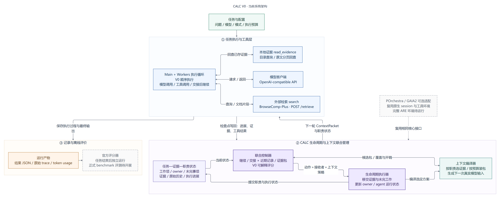

# CALC

Contribution-Aware Agent Lifecycle and Context Management：面向高效多智能体协作的生命周期与上下文联合管理框架。

CALC 将“谁继续执行、把职责交给谁、接收者获得什么信息”作为一个协作决策。当前 V0 包含可安装核心、可运行生命周期闭环、BrowseComp-Plus 模型/检索入口，以及可选 POrchestra/GAIA2 适配。研究使用现成 benchmark 的任务与官方评分。

## 方法闭环



[架构与代码映射](figures/calc-v0-architecture.md) · [矢量图](figures/calc-v0-architecture.svg) · [可编辑 Mermaid 源码](figures/calc-v0-architecture.mmd)

1. **Task–Evidence State** 保存任务、未完成职责、证据出处与版本、责任归属及原始执行历史。
2. **Joint Controller** 选择生命周期动作、接收者、工作项和上下文包。规则版用于先验证闭环；学习型贡献估计是后续可替换组件。
3. **Context Transfer Runtime** 将选择编译成下一次调用的输入视图，提交证据和未完职责后改变执行状态，并支持恢复与重新分配。

生命周期接口包含 `spawn`、`continue`、`transfer`、`merge`、`retire`、`resume`、`reassign`。首轮研究重点是继续执行与转交职责；这些动作共享状态与上下文编译器。合并指逻辑职责和证据的交接，不表示融合模型内部 KV cache。

`joint`、`independent`、`lifecycle`、`context`、`fixed` 模式用于可比实验。独立组合与联合方法应共享工具、候选上下文和资源口径，具体实验约定见 [研究协议](docs/RESEARCH_PROTOCOL.md)。

## 安装与本地检查

需要 Python 3.11 或更新版本。在项目根目录运行：

```bash
python -m venv .venv
# Linux/macOS
source .venv/bin/activate
# Windows PowerShell
# .\.venv\Scripts\Activate.ps1
python -m pip install -e ".[dev]"
python -m pytest -q
python -m calc doctor
python -m calc demo
```

`demo` 是不调用外部模型的确定性示例，用于检查状态变化和交接行为。它不产生 benchmark 分数。`doctor` 用于核对配置、依赖和上游环境；其通过也不表示正式复现已经完成。

## BrowseComp-Plus 运行入口

运行入口：

```bash
python -m calc run-browsecomp --config configs/browsecomp.local.json
```

从 `configs/browsecomp.example.json` 复制配置，填写模型、官方检索服务、任务清单、控制模式和输出目录。模型密钥通过配置指定的环境变量提供。具体配置与官方评分步骤见 [BrowseComp-Plus 接入](docs/BROWSECOMP.md)；可选环境与注册步骤见 [POrchestra/GAIA2 接入](docs/PORCHESTRA.md)。

真实运行需要可用模型 API、与 benchmark 一致的检索语料及服务，以及公开任务数据。该命令可能产生模型和检索费用，安装、单元测试和 `demo` 不要求付费模型调用。终局评分按 benchmark 官方流程单独执行，运行日志或格式正确的结果文件不能替代官方得分。

## 基线与研究顺序

工作顺序为：**复现最新强基线 → 建立 CALC 方法闭环 → 接入真实任务 → 按证据迭代。**

- 主基线：[POrchestra](https://github.com/XueyangFeng/POrchestra)，固定上游版本与原生配置后比较，保留其原始执行语义。
- 主要任务来源：[BrowseComp-Plus](https://github.com/texttron/BrowseComp-Plus)。若使用研究者划分，必须与官方全量结果区别标注。
- 迁移任务来源：[GAIA2 / ARE](https://github.com/facebookresearch/meta-agents-research-environments)。mini 清单和完整官方 benchmark 分开报告。
- 相关上下文方法：[CLM](https://github.com/facebookresearch/context-language-models)，以及协议中列出的其他最近邻。

上游依赖放在忽略的 `.upstreams/` 下，固定提交与接入状态记录在项目配置和实施文档中。核心包与可选 ARE 等环境依赖分开；某一入口存在不表示上游依赖、数据、检索索引或评分器已经安装。具体当前实施范围见 [实施方案](docs/IMPLEMENTATION_PLAN.md)。

## 验证与限制

本地行为测试覆盖职责移交、证据引用、恢复、预算超限的原子性、原始历史保留，以及不同控制模式的共同底座。上下文预算在核心层是估计量，实际实验必须同时保留模型返回的 token usage；估计 token 不能替代计费数据。

本轮验证范围是离线行为和HTTP协议。真实模型、检索索引与官方judge运行属于下一批实验。正式实验的模型、数据、资源、训练与评价约定见 [研究协议](docs/RESEARCH_PROTOCOL.md)。

## D盘代码备份

开发交付同时同步到 `D:\CALC`。备份含代码、文档、配置和测试，并写入文件哈希清单；模型数据、依赖环境、密钥和运行日志留在各自目录。开发工作区可以再次同步：

```powershell
./scripts/backup_code.ps1 -Destination D:\CALC
```
