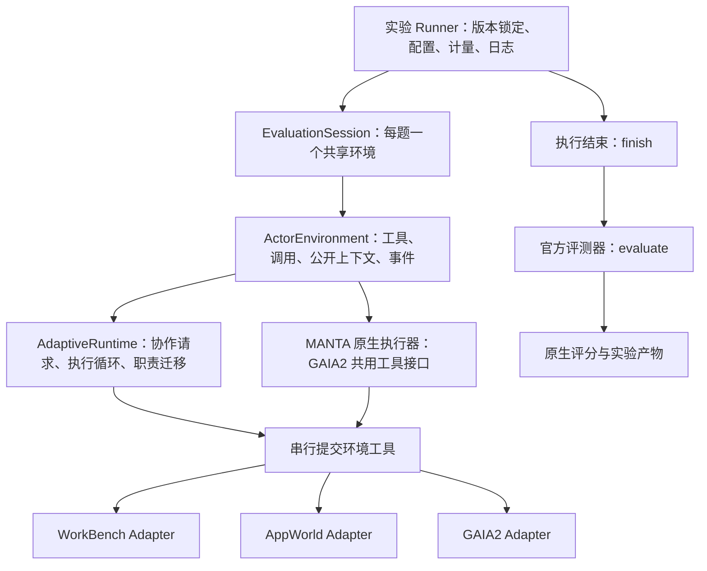

# CALC 接口与协作迭代 V2

日期：2026-11-01。旧实验源码先保存至 GitHub 标签 `gaia2-pilot5-v1-eead5b3`（`eead5b345adfa2356b617a723fc3ed5192ec05c7`）。研究与审计归档提交为 `44c8489`。本次仍在 `feat/task-progress-collaboration`，不改 MANTA 作者源码。

## 1. 为什么同时改运行时和适配层

上一轮有两个接口问题，不能归咎于任务简单或模型不愿协作：GAIA2 把结构化工具返回转为 Python 字符串；CALC 将进度报告设为业务动作的前置条件。本轮修正这些接口，并统一不同 benchmark 的公共环境边界。此次三题是已看过的开发诊断，不是独立测试集或 SOTA 证据。

## 2. 实际代码分层



- `src/calc/adaptive.py`：benchmark 无关的协作运行时；没有按数据集名称、隐藏难度或答案选择组织方式。
- `src/calc/benchmarks/session.py`：公共能力视图 `ActorEnvironment`、工具调用协议 `ToolInvoker`、生命周期 `EvaluationSession` 和所有 CALC runner 共用的 `adaptive_runtime` 构造函数。
- `ActorEnvironment` 只包含 `tools/invoke/context/events`，不含 evaluator、私有 task、标准答案、难度。它是应用接口边界，不宣称是隔离恶意 Python 代码的安全沙箱。
- `EvaluationSession` 所有 loop 共用同一实例：串行提交工具；`finish` 等待正在提交的工具结束；之后禁止继续调用工具；只有 host 可评分。评分异常原样抛出，不换评测器、不补分、不重试。
- `workbench.py` 从原 runner 抽出数据加载、工具映射与原生状态评分。AppWorld 保留官方 API 文档、无变量表达式执行与保存后评测。GAIA2 保留事件时钟、公开通知、官方 GraphPerEventJudge 与多轮结束条件。
- 不做“大一统”的评分或任务完成判据：三个原生 evaluator 的返回值原样保留，各 runner 明确提取对应 success。不同环境的时钟、资源释放和交卷方式由 adapter 决定。

新增 benchmark 的最小步骤：实现官方环境 adapter → 构造一个 `EvaluationSession` → 通过公共视图创建 CALC runtime → 在原生结束条件满足后 finish/evaluate → 增加无模型预检、信息隔离和真实工具契约测试。无需修改 `AdaptiveRuntime`。批次启动器与模型传输保持独立；本轮没有引入插件注册中心或整套外部框架依赖。

## 3. 哪些由模型决定，哪些由代码决定

LLM 判断子目标是否独立、是否存在实质冲突、继续单 loop 或分派是否划算，以及 merge/fold 是否值得；在固定操作库内提出具体下一步与交接理由。预期收益仍是模型陈述，不是已校准的真实收益。

代码保留普通工具的结构化结果与证据，记录完成/失败/阻塞/依赖和主动提议，去重后放进 inbox，在下一次正常模型请求前交付。普通 worker 工具结果不唤醒父节点。`report_progress` 是可选状态更新，不再要求 `decision=continue/change`；业务工具不因缺例行报告而取消。保持单 loop 可直接执行或回答。

模型请求可并发，工具返回在当前 wave 内提交完后才应用组织调整。迁移增加 `owner_epoch`，旧职责的迟到响应仍计量但不再执行工具。整个 loop 的未完职责迁移，接收者可读原历史并执行后续工具；`complete_transferred_work` 才释放相应后继依赖。拒绝协作提议继续原会话。

## 4. 上游参照与归属

本轮实现为 CALC 自行编写，没有复制这些项目源码、没有新增它们作为依赖。

| 参照 | 使用的具体思想 | 未照搬部分 |
|---|---|---|
| [Inspect Tasks](https://inspect.aisi.org.uk/tasks.html)、[Custom Agents](https://inspect.aisi.org.uk/agent-custom.html) | 狭窄 agent 输入；任务/求解/评分分离 | 不迁移至 Inspect executor，不改官方评测语义 |
| [Deep Agents 后端协议](https://reference.langchain.com/python/deepagents/backends)；固定源码见 research/lab_interfaces.md | 可替换能力接口；新任务状态通知及去重 | 不复制所有文件系统、容器后端 |
| Google ADK，固定提交 `95d8610` | 状态增量与控制转移分开 | 不替换 CALC 协作状态机 |
| Microsoft Agensh，固定提交 `d6063b9` | 安全执行边界注入通知、去重 | 当前 inbox 在内存中，不宣称有持久队列或崩溃恢复 |
| POrchestra，固定提交 `371aef6` | 主动状态报告、审批后原会话续跑 | 不把单活跃子 Agent 实现说成多分支迁移框架 |
| Anthropic single-agent-loop-kit，固定提交 `c437962` | 收拢循环、能力引用与上下文交接 | 工程迁移步骤不是现成在线调度器；在线触发与职责迁移是 CALC 自行实现 |

详细源码位置与许可见 `docs/research/20261101/lab_interfaces.md` 和 `code_review.md`。工程模式和实证观察提供设计依据，不构成 CALC 收益的理论证明。

## 5. 验证与运行

离线测试覆盖：普通工具不频繁唤醒父节点、可选报告错误不取消独立业务动作、通知只在下一请求边界交付、重复事件去重、请求拒绝续跑、merge/fold 后接管、职责完成释放后继、旧 epoch 返回不重复执行、共享环境串行提交、评分不可在执行期调用、评分异常无替代结果、模型视图排除私有数据。

本次实际验证：173 项 pytest 全部通过（11.26 秒）；WorkBench 真环境脚本完成 3 次工具调用并验证 fold 后接管，故意未完成 benchmark 任务，原生评分为 false；AppWorld train `82e2fac_1` 文档 API、保存与评测贯通，0 模型请求，预检不作为解题结果；GAIA2 三个锁定环境全部通过，均 0 模型请求，真实 Product 数据字段在共享接口及 MANTA 原生 compactor 后保持完整。PowerShell 与 Bash 启动脚本语法检查通过。

```powershell
D:\CALC-experiments\envs\calc-win\Scripts\python.exe -m pytest -q -p no:cacheprovider --basetemp D:\CALC-experiments\tmp\pytest-interface-final
D:\CALC-experiments\envs\manta-workbench-win\Scripts\python.exe -B scripts/check_adaptive_workbench.py
```

GAIA2 零付费预检（不加 `--execute`）：

```bash
bash scripts/run_gaia2_locked.sh --config configs/adaptive.gaia2.pilot3.v2.json
```

付费入口（仅在明确授权范围内；已存在队列会拒绝重复启动）：

```powershell
powershell.exe -NoProfile -ExecutionPolicy Bypass -File scripts/run_gaia2_locked.ps1 -Config D:\CALC-experiments\runs\gaia2-adaptability3-flash-v2\config.json
```

凭据由进程环境传入，不写配置或日志。实际批次使用独立 Windows 计划任务启动 WSL，退出不自动重启。

## 6. 三题对照锁定

按旧锁定顺序取前三题：`scenario_universe_29_aa11lh`、`scenario_universe_22_h34zyy`、`scenario_universe_21_nc6nqf`。CALC/MANTA 各一次，全 Flash，actor 4096，不额外加累计 Token/请求/Agent 人数上限。两方法并行，方法内顺序。CALC 模型并发 3；此配置限制同时请求数，不限制总 Agent 数。

MANTA 使用原生 self_evolved、repair=1、turns=2、initial=5、total=10、工具循环=8、transactional_star，作者 commit `3da40879d690a25459cc401292e5c6f0cc366d84`。两边使用同一 GAIA2 结构化工具接口；这次修正可能同样帮助 MANTA。其余原生裁剪/修复与适配限制必须报告，不能将协议故障当拓扑劣势。

记录 actor_input 与 actor_request 的 request_id、输入输出 Token、响应时间；judge 单列，不向 actor 输出评分提示。只汇总实际 actor_request/judge_request，排除重复 runtime model_call。缺 usage 单独报告。混合执行/控制调用标 mixed，不伪造精确模块 Token 归属。

## 7. 明确限制

当前仍向模型提供完整工具表及会话历史，没有实现通用工具按需发现或历史压缩。通知队列没有断点续跑。运行时按 wave 汇合模型回复，未做流式抢占调度。迁移范围仍为整个 loop，不能任意部分迁移。强/弱角色当前都为 deepseek-flash，不宣称异构模型收益。三个开发案例只验证可运行性、接口成本与触发行为，不能证明普遍准确率提升。
