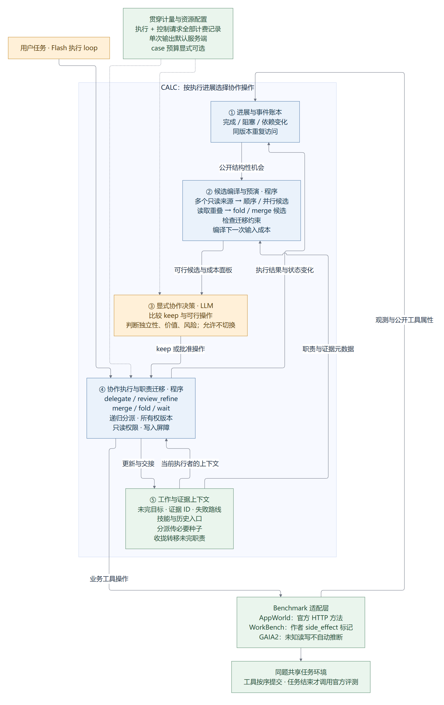

# 候选先编译，再由模型比较

## 修复目标与边界

起点为 `3870faba753a140e9984aa151b348b6d779e9055`，新分支 `feat/compiled-collaboration-triggers`。保留旧实验、冻结配置和 V0 路径；实际入口仍是 AdaptiveRuntime。

上一版有明确 DECIDE 调用，但模型能在候选编译前直接 keep。两个短题始终 keep，长题在单次输出 4096（其中全为 reasoning）后无答案结束。因此不能把没有分工简单归因于题目简单，也不能把截断直接当成需要分工的证据。

本轮把“是否进入可行候选比较”交给程序，把“采用哪个协作操作”留给模型。按公开工具属性和运行时观测构造候选，不读取任务 ID、benchmark 名称、评分、答案或隐藏难度。模型仍可 keep；没有为了展示动态性而强制切换。协作库固定，方法不搜索 Agent 邻接矩阵。



## 五个逻辑模块

| 模块 | 代码 | 职责 |
|---|---|---|
| 进展与事件账本 | progress.py；adaptive.py 的 checkpoint/notice | 完成、失败、阻塞、依赖变化、集合观测、同版本资源重叠；去重事件 |
| 候选编译与预演 | triggers.py；scheduling.py 的 preview/cost_panel | 从当前职责生成可执行候选；在分离的运行时状态上执行真实迁移校验，绝不调用环境 |
| 显式协作决策 | adaptive.py 的 _request/_accept_decision；scheduling.py | 原生 tool calling + JSON Schema 校验；比较 keep 与可行候选；服务端绑定版本，不让模型回传 opaque hash |
| 执行与迁移 | adaptive.py 的 _apply_change/_tool/run | 固定操作、递归分派、接收者接管工具执行、epoch 失效、共享环境工具提交顺序、只读约束与写入屏障 |
| 职责与上下文 | Loop/WorkState、archive、capabilities.py | 未完职责、证据、已失败路线、技能引用、冻结历史；迁移后职责级完成释放后继 |

另有 benchmark adapter/session 和 API usage 计量层。当前属于逻辑分模块，AdaptiveRuntime 仍承担多数状态机代码，尚未拆成五个包。

## 哪些是硬代码，哪些交给模型

程序把两个及以上、同世界版本、尚未分派的只读集合来源编译为 parallel 和 sequence 备选。每个来源只形成一个读取职责；分页与更多对象不会按对象数直接扩张团队。来源的读写语义由 adapter 的公开元数据提供。两个来源只是结构上可形成备选，不表示语义独立，也不表示预计省 Token。

只读 loop 与另一执行者对同一资源、同一世界版本取得同一结果时，程序形成 overlap 事件，可编译 fold；有活跃只读兄弟接收者时也比较 merge。没有“重复 N 次就自动折叠”。只迁移整个 loop 的职责，不宣称支持任意细粒度部分迁移。

预演为每个备选检查现有状态机约束，保留可行备选。某个 merge 不可行不妨碍比较可行 fold；所有备选不可行会记录原因，继续现有显式决策路径，绝不把失败的迁移当已执行。

模型判断任务相关性、独立性、上下文专业化是否值回控制成本，以及采用 keep/sequence/parallel/fold/merge。独立核查 review_refine 仍可由模型基于证据提出，编译器不凭列表形状自动断言结论冲突。Main 和 Worker 都保留请求调整和递归分派。

控制输入是职责、事件、来源和证据元数据的紧凑视图；工具参数移除常见认证字段，不重放全部求解历史。调度响应不再回传 evidence_ids；运行时从通过版本检查的快照绑定真实证据。业务执行者的 report_progress/collaborate 证据接口仍保留。没有新加每步 LLM Judge。成本面板显示实际编译的下一次求解输入 UTF-8 字节及历史实测调用；不伪装成准确 Token 预测、剩余总费用、成功概率或已实现收益。

授权恢复后进一步收紧调度接口：控制输入显式提供 business_capabilities 和 registered_skills；提议中的工具/技能名称按当前注册表生成枚举，空技能集合只能省略或为空。底层 API 标签不当成 callable 工具名。调度提议不再包含嵌套 reason/proposed_next，而从外层 reason/next_work 单次声明绑定；source_family 和分支证据引用由编译器/运行时负责，不让模型自行编造。此修订经过386项回归，但尚未再次进行付费运行。枚举是模型可见约束加运行时校验，不等于当前非strict提供方保证生成合法值。

## 真正执行与上下文接管

分派的只读 Worker 共享同题环境，使用已经取得的种子证据和原历史入口，不复制一个独立任务世界。模型请求仍可并发，组织决策与工具提交经过共享状态屏障。读取分工结束前，父节点不能执行写/未知效果；只读约束递归继承。fold 后写入屏障继续保留，直到接收者调用 complete_transferred_work 完成迁移职责。来源 loop 的对应职责停止执行，旧 epoch 响应不会再提交工具。

公开元数据缺失时标为 unknown，不猜测为 read；未知操作不能在只读职责中执行。世界版本在写/未知操作前前进（错误也可能产生副作用），旧读取集合不会被误认为仍属于当前只读前沿。

AppWorld 使用官方 api_docs.method；WorkBench 保留作者 side_effect；GAIA2 尚无可靠 effect callback，不启用这种自动多来源读取编译，仍保留原显式调度和操作能力。所有 bench 的模型输入仍与评分接口隔离，结束后才评测。

## 借鉴来源与许可证

本轮新代码均为独立实现，没有把无明确整体许可的 POrchestra 源码复制进来。保留已有来源记录和作者归属。

| 上游设计 | 借鉴到 CALC 的部分 | 没有照搬的内容 |
|---|---|---|
| [Magentic-One，AutoGen d07c667](https://github.com/microsoft/autogen/blob/d07c667a3239ea4ab7af62a53b0f4ff205a1f23d/python/packages/autogen-agentchat/src/autogen_agentchat/teams/_group_chat/_magentic_one/_magentic_one_orchestrator.py)，MIT | 独立的调度机会、进展账本和程序控制状态转移，组织决策不依赖业务执行者偶然自发调用 | 它的停滞计数与 max_stalls=3、预注册团队，不当作本方法的收益阈值或固定人数 |
| [MANTA planner，3da40879](https://github.com/mao-code/MANTA/blob/3da40879d690a25459cc401292e5c6f0cc366d84/MAS/self_evolved/planner.py)，MIT | 将决策落实为固定操作的可执行 specification；候选生成、合法性检查与执行分开 | 图拓扑优化、transactional_star 固定人数、原生 4096 与 8 次工具循环不移植到 CALC |
| [Anthropic single-agent-loop-kit，c437962](https://github.com/anthropics/single-agent-loop-kit/blob/c43796287b83bec847db923f07131d1cc8de750d/reference_loop/loop.py)，Apache-2.0 | merge/fold 的职责迁移思路、按需能力、公开工具副作用约束、共享预算思路 | 它的迁移步骤不等于在线调度器；截断路径是停止而非自动展开团队 |
| [POrchestra DelegateTaskTool，371aef6](https://github.com/XueyangFeng/POrchestra/blob/371aef619aec6f2918690a2fbaf9bf797b3025d3/porchestra/tools/delegate.py) | 普通工具本地继续、显式 revise/finish 边界、调整后保留会话 | 没有将其单活跃 SubAgent 描述成已有多分支 merge/fold，也没有复制无整体许可证源码 |

## 输出与 case 资源限制

CALC 单次 `max_output_tokens` 现在默认 None；请求不发送 max_tokens/max_completion_tokens，由提供方默认决定。显式正整数仍支持。服务端仍有有限默认值，不是无限输出。MANTA 原版及历史 4096 冻结实验保持原记录。

支持可选 `max_case_tokens` 和 `max_case_requests`，每个 case 实例共享 Main、所有 Worker 和调度/整理请求，默认均 None。Token 按返回 usage 累加，达到后停止发起新请求；当次/已在途请求可能超出额度，因此不是严格账单硬上限。有缺失 usage 且设置 Token 额度时，明确停止为 usage_unknown，不按 0 继续。评测独立记账，结束评分不被 actor 预算截断。没有暗加团队数、请求数或累计 Token 默认上限。

可选 output_pressure_review 会对 finish_reason=length 拒绝执行不完整工具批次，并打开重评估；保持单 loop 时要求下一步为一个已加载工具的有界动作。相同执行状态再次耗尽则明确失败，不循环付费重试。**本轮示例和三个授权 case 均关闭此选项**，先移除客户端 4096 干扰；该策略是 CALC 实验设计，不能说是直接复用了上游默认处理。

## 验证与下一轮运行

首个冻结版本 2ed9ff9 的无付费回归：380 tests passed，Ruff passed。首次执行全套测试遗漏 PYTHONPATH 导致 CLI 子进程无法导入；补齐与正式运行一致的环境后全套通过，未为测试改 CLI 行为。随后三个真实调用暴露了事件/证据 ID 混淆，见 COMPILED_THREE_CASE_20261102.md；该缺陷已单独修复并新增回归，不把旧失败轨迹用修复版本解释。

```bash
cd /mnt/d/CALC-experiments/code/CALC-task-progress
PYTHONDONTWRITEBYTECODE=1 TMPDIR=/opt/calc/tmp PYTHONPATH="$PWD/src" \
  /opt/calc/envs/gaia2/bin/python -m pytest tests -q -p no:cacheprovider
/opt/calc/envs/gaia2/bin/ruff check src tests scripts
```

授权下一批：WorkBench multi_domain_0；AppWorld train 82e2fac_1、6104387_1；同一冻结提交、全部 Flash、单次输出默认服务端、case 总预算未填数字。先锁数据/无付费预检，再执行。不跑 MANTA、不自动补跑。新旧输出策略不同，不能把差异全部归因于协作，也不能把 3 个开发 case 当 SOTA 结果。

运行入口：WorkBench 使用 `scripts/run_adaptive_workbench.py --config <frozen-config>` 预检，加 `--execute` 执行；AppWorld 先 `--lock-data`，无 `--execute` 预检，加 `--execute` 运行。锁数据/官方版本/配置 SHA/源码归档在实验目录，所有实验存储位于 D 或其 D-backed WSL。
