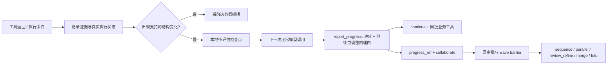

# 进度检查点迭代：首次分派、独立进度报告与低开销评估

开发起点：`79218d5b28b755dbf22b9a884b4f4f108663bda3`，继续在
`feat/task-progress-collaboration` 上实现。旧 AppWorld 单题的结果和轨迹不修改。

## 对原问题的三项修改

| 原问题 | 新实现 | 不能据此宣称 |
|---|---|---|
| 首次分派主要靠模型自发想起 collaborate | 任务开始、新主结果集合、计划/依赖变化、接管职责和父节点进展事件产生明确检查点；下一次正常求解必须评估已看到的检查点 | 发现多个对象就值得分派 |
| 不调用 collaborate，任务进度一直停在初始化摘要 | 独立 report_progress 更新本地进度、下一步、子目标及依赖；执行事实/版本和语义报告新鲜度分别展示 | 结构化报告等于真实成功率 |
| 申请改变组织要重复填写大量上下文 | progress_ref 引用最新报告；允许 report_progress 与业务工具或 collaborate 同一响应 | 协议一定降低总 Token，需要真实计量 |

代码不会判断子目标“语义独立”。运行时识别对象集合、声明计划的差异、完成、失败、依赖和迁移等事实；
LLM 判断保持或改变协作，给出证据和理由。所有检查点都可以选择 continue。
merge/fold 仍需模型提出、经原权限/审批检查后执行；不会按对象数、步数或重复次数自动收拢。

## 阅读并借鉴的 GitHub 设计

本次阅读了具体实现，不仅阅读 README。以下内容均为机制借鉴和独立实现，没有复制上游函数、提示全文或引入框架依赖。

1. **Magentic-One：Task Ledger / Progress Ledger 分离。**
   [orchestrator 源码](https://github.com/microsoft/autogen/blob/d07c667a3239ea4ab7af62a53b0f4ff205a1f23d/python/packages/autogen-agentchat/src/autogen_agentchat/teams/_group_chat/_magentic_one/_magentic_one_orchestrator.py)
   与同目录 `_prompts.py`：分别管理任务事实/计划、是否取得进展、重复、下一步执行者。
   借鉴的是独立记录任务进展及下一步选择；未照搬每轮额外 orchestrator 模型调用、固定参与者集合、
   max_stalls 阈值重规划和最多10次 JSON 修复循环。
   固定查阅提交 `d07c667a3239ea4ab7af62a53b0f4ff205a1f23d`。
   代码许可为仓库 LICENSE-CODE 的 MIT（Microsoft）；根 LICENSE 是文档 CC BY 4.0，不能混淆。

2. **LangChain TodoListMiddleware：执行者自己的轻量计划工具。**
   [todo.py](https://github.com/langchain-ai/langchain/blob/6671bf76d3e1cb3ae5fc38aabca409879e602050/libs/langchain_v1/langchain/agents/middleware/todo.py)
   的 write_todos 更新独立状态，限制同一响应多次覆盖同一计划。
   借鉴为 report_progress，单个响应最多一次写入、可与业务动作同批提交。
   没有照搬其按任务步数判断是否使用 todo 的提示；检查点来自明确事件。
   固定提交 `6671bf76d3e1cb3ae5fc38aabca409879e602050`，MIT（LangChain）。

3. **Deep Agents：清楚表达分派工具用途和上下文边界。**
   [subagents.py](https://github.com/langchain-ai/deepagents/blob/220aff708682ad0883469a00531e5c4d958b47ec/libs/deepagents/deepagents/middleware/subagents.py)
   的 task 工具描述强调独立任务可以并行、对子任务说明输入与期望产物。
   本实现保留固定协作操作，使用报告引用减少分派表单重复；仍保留 CALC 的递归会话与 merge/fold，
   没有替换成其默认的一次性 subagent 调用。
   固定提交 `220aff708682ad0883469a00531e5c4d958b47ec`，MIT（LangChain）。

POrchestra 的主动状态报告/原会话继续、Anthropic 的技能和 loop 收拢设计继续沿用；
来源及边界见前版 TASK_PROGRESS_COLLABORATION.md。

## 事件如何进入同一次正常决策



report_progress 会先于同批业务工具提交，无论模型把它列在哪个位置。它只能引用此前已得到的证据，
不能声称已经知道同批尚未执行工具的输出。报告和组织调整可以同批，组织调整和业务工具仍不能同批。
因此原来的“所有并发返回及工具提交完成后再迁移职责”边界不变。

检查点以 loop 内的唯一 ID 表示，按事实身份去重。同集合重排、同报告重传不会创建新的评估。
每个模型请求开始时由运行时快照状态版本和待评估 ID，报告自动绑定这个快照，模型不用填写二者。
如果并发消息已改变该 loop 的状态，旧请求的报告会显式拒绝，不能被悄悄标记为“看过最新进展”。
该修复所需的正常模型请求同样计量。初次实跑版要求模型手填 observed_version/checkpoint_ids，
这造成额外修复，已在实跑后的代码中移除；原实跑不重写为修正版结果。
如果模型漏掉必须的报告，返回显式协议错误，同批业务工具不执行；后续正常修复调用照实计费。
没有专门 Judge、自动补报告、自动重试或默认猜测“继续”。
只有待评估事件时需要报告，不要求每次工具返回都写报告。简单任务可以一次
report_progress(answer=...) 同时评估并完成，不固定增加一个模型往返。

### 支持的结构事实与限制

- 初始任务；父节点已有的完成/失败/请求/依赖事件；接管未完成工作。
- 顶层 JSON 列表，或 results/items/records/data 主结果封装中，具有共同 id 或 *_id 字段的多个不同对象：记录集合数量、字段、证据引用和集合身份。
- 模型声明的子目标列表发生变化（含依赖或状态变化）：同一报告同时记录变化和评估。
- 普通工具参数/调用错误保留本地修复，不强制再评估组织；终态失败及 report_progress 的 blocked/conflict/overlap 信号通知父节点。

对象集合检测是有限的结构检测，不是通用任务理解：纯文本、没有稳定 ID 的集合不会自动识别；
单条记录附带的 artists/tags 等列表不视为新的主工作集合；
集合的 IDs 不变而属性改变，也不会仅凭属性变化再创建集合事件。语义冲突和新增子目标仍由执行者报告。
事实事件不会自动唤醒父节点；普通子工具与普通进度报告留在子 loop，明确请求或问题才上报。

## 两个工具如何搭配

保持单 loop：同一次响应可以先报告再调用业务工具。

```json
{
  "report_id": "p2",
  "summary": "发现多个候选对象，但排序接口可直接缩小搜索范围",
  "next_step": "Main 查询排序接口并核对候选",
  "evidence_ids": ["e8"],
  "decision": "continue",
  "reason": "一次直接查询可能避免多个分支重复读取和汇总"
}
```

需要改变时，report_progress 使用 decision=change，然后同响应调用：

```json
{
  "operation": "delegate",
  "progress_ref": "p3",
  "reason": "两个来源需要独立调查",
  "proposed_next": "两个 Worker 各自调查一个来源，Main 汇总",
  "expected_savings": "预期并行调查减少等待，尚未测量",
  "risks": "可能增加上下文传递成本",
  "pattern": "parallel",
  "branches": [{"goal": "调查来源 A"}, {"goal": "调查来源 B"}]
}
```

事件版本、进度、证据、保持原样的下一步和交接包从不可变报告引用取得。
引用过时、跨 loop、重复 ID 改写或与 continue 决策矛盾会明确拒绝；不会静默使用旧信息。
旧完整提议协议仍显式支持，用于已有适配器，不是解析失败后的备选分支。

## 对照与计量

四种模式 single / initial_static / no_merge_fold / full 共用同一进度接口与检查点配置。
`progress_checkpoints=true` 为默认值，在示例配置中显式写出。
状态机老回归用 false 隔离原拓扑协议；新检查点测试用 true，真实 WorkBench 贯通也用 true。
没有按基线名称关闭某一方检查点，也没有新增总 Token/请求/人数上限。

`control_calls` 现在包括含 collaborate 或 report_progress 的调用；`execution_calls` 是其余调用，
二者相加等于总请求。混合报告/业务动作的响应在 control_calls 中只计一次。
另记 progress_calls、progress_checkpoints、progress_assessments、continue_decisions、
progress_protocol_errors；报告、修复、规划等消耗全部进入真实 usage。
checkpoint 数与报告数不是必然一一对应，一个报告可以处理多个事件。

## 验证与运行

新增 `tests/test_progress_checkpoints.py` 覆盖20个测试实例：首次分派、发现新集合后再分派、
继续单 loop、进度和动作同批、拒绝伪造未来证据、重复报告、计划依赖变更、过期引用、
多写入原子拒绝、fold 后实际接管、四种模式等。原拓扑、职责释放、并发和 AppWorld 隔离回归保留。

执行前验证：完整 WSL 回归156项通过，Ruff通过；真实 WorkBench 工具贯通8个脚本决策、
3次业务调用、4个检查点和4次评估，无付费模型调用；AppWorld 官方零模型预检通过，耗时25.773秒。
预检只查询文档而未做题，原生评分 false 是预期值，不能当作模型成绩。

真实单题复测使用同一个 train ID `82e2fac_1`，Flash/4096/并发3及官方环境设置不变，
数据锁不变，新目录 `D:\CALC-experiments\runs\appworld-task-progress-case1-v2`。
执行命令仍为：

```bash
cd /mnt/d/CALC-experiments/code/CALC-task-progress
/opt/calc/envs/appworld/bin/python -B scripts/run_adaptive_appworld.py --config configs/adaptive.appworld.case1.json --execute
```

先跑完整测试和不带 --execute 的官方零付费预检，再执行用户授权的这一题。
模型是否选择分派以实际轨迹为准，不能拿脚本分派测试当成真实模型的动态协作结果。

## 实跑后修正

真实运行提交 0bbd0ea 的单题官方判错，全部结果及成本见
[复测记录](APPWORLD_CHECKPOINT_CASE1_20261101.md)。没有付费重跑或修改判分。
根据这次开发轨迹做了三项修正：由运行时绑定报告版本/事件，排除附属列表及可本地修复的参数错误触发，
在 AppWorld 工具使用说明中提醒分页完整性以及按用户要求提交精确值。
未加入本题答案、具体歌曲/分页常数、评分代码或自动答案清洗；评分器不变。
修正后的真实任务表现尚未复测；不能把离线测试当作修正版单题成功。
