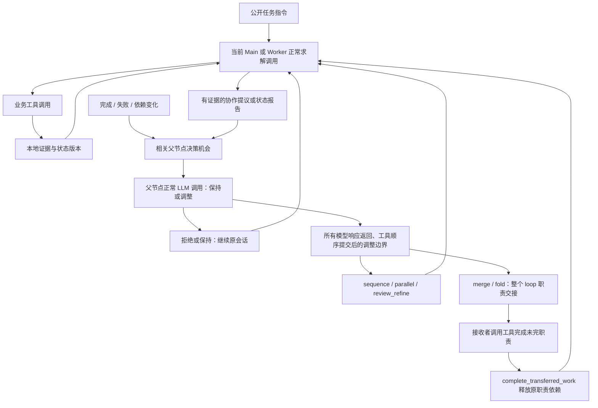

# CALC：按任务进展调整协作

## 版本与实现边界

分支 `feat/task-progress-collaboration`，起点 `28e99aeda597c0b4a6303254fec2b7e9513fa081`。
创建时本地与远端 `feat/calc-v0` 一致。使用独立 worktree
`D:\CALC-experiments\code\CALC-task-progress`，原开发目录的未提交报告、图和实验记录未被覆盖。

本轮修改实际 WorkBench 入口使用的 `AdaptiveRuntime`。V0 的 `JointController`、
`ContextCompiler` 没有接入这条路径。strong/weak 是路由接口名称，两个配置都为
`deepseek-flash`；本轮没有强弱模型收益或训练收益的主张。

## 哪些由模型决定，哪些由代码执行

模型判断子目标独立性、实质冲突、分工价值、交接损失，以及是否保持现状。
固定操作集合为 continue、delegate(sequence/parallel/review_refine)、merge、fold、wait、escalate。
Worker 提议由其父节点在正常调用中 respond；Main 可直接调整自己拥有的范围。
没有每一步独立运行的 LLM Judge，没有按 benchmark、题号、答案或隐藏难度选结构。

代码维护 loop、职责、依赖、证据、版本和操作权限。普通工具结果只留在执行者；
完成、失败、明确阻塞、依赖改变或主动调整请求提供父节点决策机会。
重复资源访问只产生本地事实提示，不触发自动 fold。重复提议根据操作、工作报告、
真实观察和有关职责版本去重；只改理由或 event_version 不算新增事实。
自然语言工作报告是否语义相同没有额外模型判定，当前去重是结构化相等，仍可能被改写绕过。

提议包含事件类型/版本、工作范围与进展、完成条件、未解决事项、失败路线、证据 ID、
保持不变时谁做什么、调整后的具体下一步、预期开销收益及损失、交接说明。
这些是模型陈述，不能当作校准收益。被拒绝后保留原消息历史并继续执行。

merge/fold 迁移范围为整个 loop，不支持任意部分职责切片。交接包包含源版本、
未完目标与工作报告、依赖、证据来源/版本、技能引用、近期历史及原始历史读取入口。
接收者实际调用后续工具，来源停止执行。`complete_transferred_work` 显式完成原职责，
让顺序后继释放，不要求接收者整个 loop 先结束，也不代表 benchmark 判对。
不迁移仍有活跃子节点或未满足外部依赖的 loop；先处理相应子职责/依赖。

模型请求可并发；一轮全部返回后顺序提交工具，再处理组织调整。调整期间没有旧 loop
在途模型/工具调用。代价是 wave barrier 受最慢请求影响；本轮没有做抢占式取消或异步调度。
没有新增默认人数、累计请求或累计 Token 上限；`concurrency` 只限制同时模型请求，
`max_output_tokens=4096` 是单次输出上限，`max_waves=null`。

## 共同底座上的四个对照

| 模式 | 允许的组织操作 | 解释 |
|---|---|---|
| `single` | continue | 单 loop，业务工具和模型相同 |
| `initial_static` | 开始阶段 Main 一次 delegate，之后 continue/wait | 首个业务动作或组织决定后关闭建队窗口 |
| `no_merge_fold` | continue/delegate/wait/escalate/respond | 可动态展开和切换分工，不收拢 loop |
| `full` | 全部操作 | 动态展开、核查修正、merge/fold |

initial_static 不做运行中的递归建队；其他动态模式保留 Main/Worker 递归分派。
操作许可同时写入模型状态和运行时校验，不通过四份实现制造差异。
下一批可使用固定 train 三题 `82e2fac_1,82e2fac_2,82e2fac_3` 做接口开发对照，
三题来自同一任务家族，不能作为跨任务泛化证据。四组相同 Flash、4096、并发3、环境参数；
每组单独官方任务环境、输出目录和数据锁。目前仅授权 full 模式第一题真实模型运行。

## AppWorld 官方环境

官方源码固定 `42b5bcf3cd334fee33f0c37c02070a9f5807add5`，代码包 `0.2.0.dev0`，数据 `0.2.0`。
另锁定所选任务、基础数据库和 API 文档 SHA256。开发入口仅允许 train/dev，
通过公开划分顺序选题，不读取隐藏难度。数据引用只作字节哈希，不进入模型。

每题只建立一个 `AppWorld(load_ground_truth=False)`，所有 loop 共享这一个世界。
模型只见任务 instruction、datetime、公开 supervisor 字段和官方 API 文档。
统一 `appworld_api(app, api, arguments_json)` 只调用任务公开目录内的官方 API。
执行器生成 `print(apis.app.api(**literal_arguments))`，模型不能提交任意 Python，
没有跨 loop 的 Python 变量。工具提交持锁并串行；交接的是证据/职责，不是隐式解释器变量。
这比官方任意 Python 编程代理的表达能力小，属于显式接口设计，须在比较时共同使用。

结束执行后先保存官方状态与日志，再调用官方 `evaluate_task`。运行时没有评分接口，
判分结果不返回模型。AppWorld 返回的 API 错误文本仍是官方执行观察，不替换成成功响应。
只提供正常工具错误反馈，不重试模型、不生成兜底答案、不更换评分器。
Main 提交 supervisor.complete_task 的约束写在提示中；当前适配器没有按调用者身份的硬门控。

官方环境的 `max_interactions=1000`、`max_api_calls_per_interaction=5000`、
`timeout_seconds=100`、`random_seed=100` 在配置中显式固定；它们不是额外累计 LLM 预算。
max_tokens 截断不执行不完整工具调用，计入 finish_reason 和成本。

## 上游复用与归属

| 来源 | 实际使用方式 | 边界/许可 |
|---|---|---|
| [POrchestra](https://github.com/XueyangFeng/POrchestra/tree/371aef619aec6f2918690a2fbaf9bf797b3025d3) | 阅读 ReActSubAgent、DelegateTaskTool.revise_active、MainMemoryBus 后，自行实现状态报告、父节点决定、原会话继续、原始证据入口 | 查看的固定提交未发现 LICENSE，未复制源码；其公开实现主要维护一个活跃 SubAgent，不能声称原生支持本实现的多分支/merge/fold |
| [Anthropic single-agent-loop-kit](https://github.com/anthropics/single-agent-loop-kit) | 独立实现 load_skill、能力和未完工作收拢到一个 loop 的思路 | Apache-2.0；不是调用它的迁移脚本，也不声称它提供在线调度器。阅读 reference_loop/loop.py blob 0ba33b8d214987f636bc4594c9572bba18e9fa87 |
| [DynaFlow](https://github.com/amiya-special/Dynaflow) | 核对 workflow 的执行、消息会话和工具交接，作为设计对照 | MIT，Liu Ruhao；未引入自由代码生成或容器 workflow 框架 |
| [AppWorld](https://github.com/StonyBrookNLP/appworld/tree/42b5bcf3cd334fee33f0c37c02070a9f5807add5) | 真实调用 AppWorld、官方 API、官方 evaluate_task | Apache-2.0 及其数据分发条款；环境和数据不复制进 CALC 仓库 |

已有 `scripts/baselines/porchestra`、`scripts/baselines/dynaflow` 保留；没有把这些旧适配器
描述成本轮 AdaptiveRuntime 已经调用的组件。

## 计量与结果解释

每个真实请求记录模型、usage、finish_reason、耗时及是否含 collaborate。
execution_calls/control_calls 是互斥统计；控制提议包含在同一模型响应中时只计一次。
规划、审批、工具修正、交接和历史读取引起的所有调用都进入总账。
usage 缺失的请求单列；此时 Token 合计只能视为已报告下界，不能报为完整成本。
墙钟与模型计时绑定真实 monotonic 时钟，不使用 AppWorld 冻结的任务日期。
分别报告官方成功率、运行正常完成率、输入/输出 Token、请求数、控制调用、协作请求、
实际切换和墙钟。运行完成不等于正确；单题结果不能证明胜过 MANTA 或证明动态协作有效。

测试和运行命令见 [AppWorld 运行说明](APPWORLD_RUNBOOK.md)。
