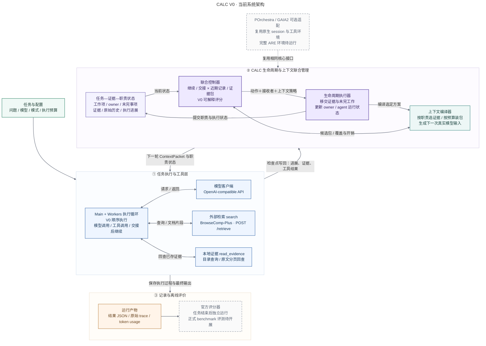

# CALC V0 当前架构

对应代码提交：3e1a775。日期：2026-10-31。

主运行路径为 BrowseComp-Plus。Main 与 workers 在 V0 顺序执行；POrchestra/GAIA2 作为复用相同核心接口的可选适配，完整 ARE 环境尚未实际运行。

## 如何读图

1. 执行循环调用模型与检索工具，把返回内容和进展写回 TaskState。
2. JointController 读取当前状态，通过 ContextCompiler 构造候选上下文并评估覆盖/开销，共同选择 continue/transfer 与 recent/evidence。
3. LifecycleRuntime 先编译可提交的上下文，再迁移职责、改变 owner 与 agent 状态；选定 ContextPacket 进入下一次真实模型请求。
4. 原始证据与历史保留在状态/轨迹中，read_evidence 支持本地分页回查。
5. 结果、trace 与 usage 分别落盘；官方评分发生在任务执行后，不向在线控制器提供答案。

## 代码映射

| 图中模块 | 实现 |
|---|---|
| Main / Worker 与工具循环 | src/calc/adapters/browsecomp.py::run_task |
| 模型客户端 | src/calc/llm.py::OpenAICompatibleClient |
| 任务—证据—职责状态 | src/calc/state.py::TaskState |
| 联合控制器 | src/calc/controller.py::JointController |
| 当前评分器 | src/calc/controller.py::HeuristicValueModel |
| 上下文编译 | src/calc/context.py::ContextCompiler |
| 生命周期执行 | src/calc/lifecycle.py::LifecycleRuntime |
| 可选 GAIA2 适配 | src/calc/adapters/porchestra.py |

## 当前边界

- 控制器当前评分的候选为 continue/transfer × recent/evidence；完整生命周期执行接口还支持 spawn、merge、retire、resume、reassign。
- 上下文包有预算；实际模型请求还包含共享指令与最近完整工具轮次。
- 当前使用可解释评分器；学习型 ranker、自适应 spawn 和多 worker 并发属于后续迭代。
- 73 项本地离线测试及四组 GitHub CI 已通过；真实模型、官方检索/评分和完整 ARE 环境的 benchmark 运行尚待开展。

## 导出文件

- calc-v0-architecture.png：适合直接插入汇报。
- calc-v0-architecture.svg：矢量图。
- calc-v0-architecture.mmd：可编辑 Mermaid 源码。
